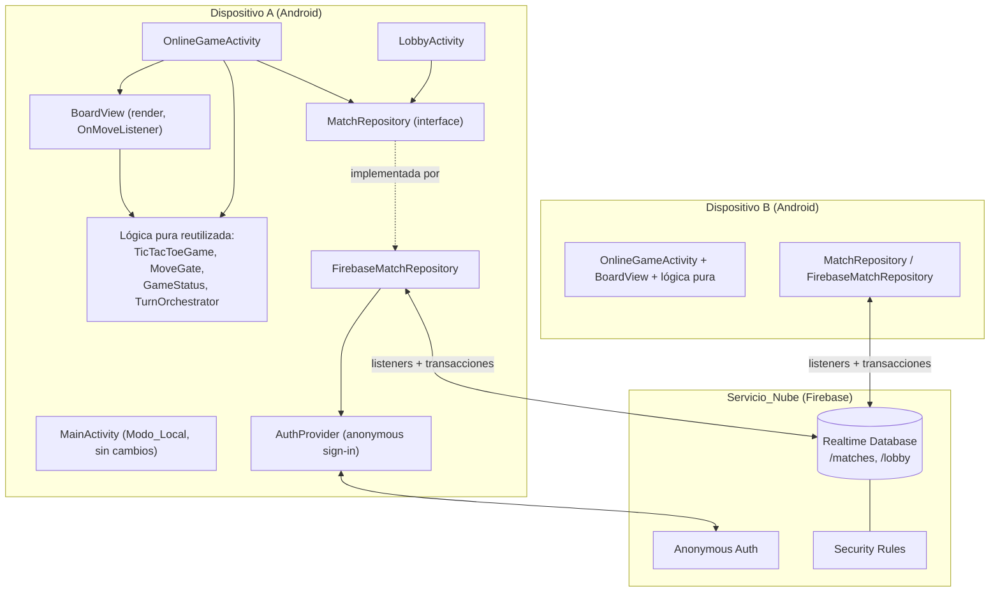
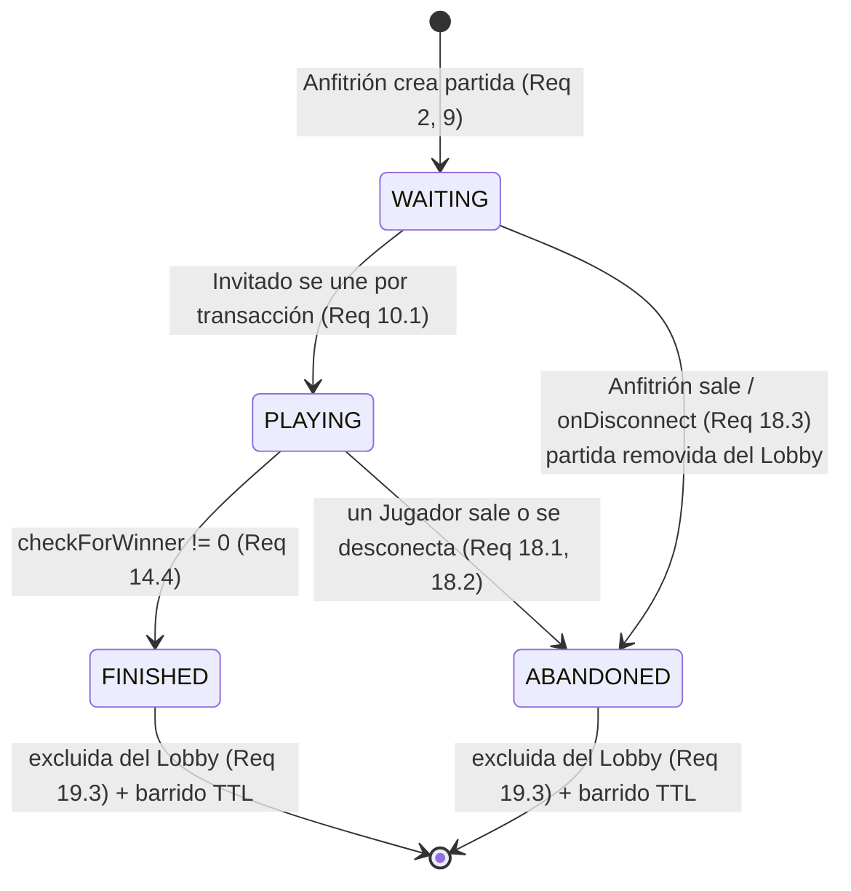

# Design Document

_Documento de Diseño — Modo Multijugador en Línea ("Jugando Triqui Online", Reto 7)_

## Overview

Esta funcionalidad añade un **Modo_Online** multijugador de dos dispositivos a la aplicación Android de Triqui (`co.edu.unal.reto4_tictactoe`), mediado por un servicio en la nube que actúa como **fuente autoritativa** del estado de cada partida. El modo local existente (Humano X vs. Computadora O) se conserva **intacto**; el modo en línea es **aditivo** (Req 21).

Decisiones de alto nivel que este diseño resuelve (corresponden a las "Decisiones pendientes" de `requirements.md`):

| # | Decisión pendiente | Elección de diseño | Justificación |
|---|---|---|---|
| 1 | Configuración de Firebase | Firebase Realtime Database (RTDB) + Firebase Anonymous Auth; adiciones de Gradle/catálogo **especificadas pero no aplicadas** en esta fase | RTDB ofrece sincronización en tiempo real y transacciones atómicas; Anonymous Auth da un `uid` estable sin perfiles complejos (fuera de alcance). Tocar Gradle queda fuera de alcance (ver §Architecture → "Adiciones de Gradle"). |
| 2 | Arquitectura de pantallas | **Dos Activities nuevas**: `LobbyActivity` y `OnlineGameActivity`, dejando `MainActivity` (local) sin cambios | Separación clara de responsabilidades y de ciclo de vida de listeners; `MainActivity` no se contamina con lógica de red. |
| 3 | Reconexión | Presencia + `onDisconnect` de Firebase y **re-sincronización** desde el estado autoritativo al re-adjuntar listeners | Mecanismo nativo de RTDB; evita estados inconsistentes (Req 16.3, 23.2). |
| 4 | Limpieza / TTL | `onDisconnect().removeValue()` para partida ESPERANDO huérfana del Anfitrión; marcas de tiempo (`createdAt`/`updatedAt`) + barrido perezoso para FINALIZADA/ABANDONADA | Retira partidas muertas del Lobby sin servidor dedicado (Req 18.3, 19.3). |
| 5 | Asignación X/O | **Anfitrión = X (juega primero), Invitado = O** | Regla fija y determinista; alinea con "X mueve primero" (Req 11.3) y simplifica el gating de turno. |
| 6 | "El profesor juega con el estudiante" | **Lista global compartida de partidas ESPERANDO** (lobby global) como mecanismo principal; unión por código (`matchId`) como alternativa opcional | Un lobby global cumple Req 7 de forma directa; se asegura con Reglas_Seguridad (solo lectura de la lista a usuarios identificados). |
| 7 | Estrategia de pruebas | jqwik (property-based) sobre la **lógica pura reutilizada**; integración/humo con 1–3 ejemplos para la capa Firebase **detrás de una abstracción** | Probar la lógica donde la variación de entrada aporta valor; no ejecutar 100 iteraciones contra un servicio externo (Decisión pendiente 7). |
| 8 | Reglas de prueba vs. producción | Boceto de ruleset de producción bloqueado + procedimiento documentado de reemplazo del modo de prueba | Cumple Req 22.5/22.6; sin credenciales reales (Req 22.7). |

El eje del diseño es una **capa de repositorio/abstracción** (`MatchRepository`) que envuelve a Firebase. La UI y la lógica pura reutilizada (`TicTacToeGame`, `TurnOrchestrator`, `MoveGate`, `GameStatus`, `BoardView`) **no dependen directamente de las APIs de Firebase**. Esta abstracción es también lo que hace la capa de nube **intercambiable para pruebas** (un `FakeMatchRepository` en memoria sustituye a `FirebaseMatchRepository`).

> **Nota de separación:** Los **Requisitos del profesor** (Req 1–7) y los requisitos de seguridad (Req 22) son de cumplimiento estricto. Las **decisiones técnicas propuestas** (Firebase, RTDB, asignación X/O, lobby global, dos Activities) son elecciones de este equipo y se marcan como tales a lo largo del documento.

## Architecture

### Vista general

El sistema tiene dos lados: el **cliente Android** y el **Servicio_Nube** (Firebase RTDB + Auth), que es la **fuente autoritativa** del `Estado_Partida` (Req 6.1). Toda propagación de cambios ocurre a través de la nube, nunca entre dispositivos directamente (Req 6.2). El cliente reutiliza la lógica pura para **renderizar y validar en el cliente como capa de UX**, pero la autoridad vive en la nube (Req 20.4, 22.1).



### Ciclo de vida de la partida (Ciclo_Vida_Partida)

Los estados autoritativos viven en el campo `status` de cada partida (Req 1, 10, 12, 18, 19). Nombres canónicos: `WAITING` (ESPERANDO), `PLAYING` (EN_JUEGO), `FINISHED` (FINALIZADA), `ABANDONED` (ABANDONADA).



Transiciones clave:
- `WAITING → PLAYING`: solo por **transacción** que reclama el slot de Invitado (Req 10.1, 10.2).
- `PLAYING → FINISHED`: cuando una transacción de movimiento produce `checkForWinner() != 0` (Req 14.4).
- `* → ABANDONED`: por salida voluntaria o `onDisconnect` (Req 18).
- Mientras `WAITING`, no se permiten movimientos (Req 5.2, 12.3).

### Adiciones de Gradle (implementación futura — NO aplicadas en esta fase)

> **Decisión pendiente 1.** El proyecto hoy **no** incluye Firebase (sin plugin `google-services`, sin `google-services.json`, sin Firebase BoM). Las siguientes adiciones se documentan como **tarea de implementación**, no se realizan ahora. Debe evaluarse compatibilidad con minSdk 24, compileSdk/targetSdk 37, AGP 9.3.3, Java 11 antes de comprometerlas.

1. **`gradle/libs.versions.toml`** — añadir:
   - En `[versions]`: `googleServices = "<versión del plugin google-services>"`, `firebaseBom = "<versión del Firebase BoM>"`.
   - En `[libraries]`: `firebase-bom = { group = "com.google.firebase", name = "firebase-bom", version.ref = "firebaseBom" }`, `firebase-database = { group = "com.google.firebase", name = "firebase-database" }` (sin versión; la fija el BoM), `firebase-auth = { group = "com.google.firebase", name = "firebase-auth" }`.
   - En `[plugins]`: `google-services = { id = "com.google.gms.google-services", version.ref = "googleServices" }`.
2. **Proyecto raíz (`build.gradle.kts` del proyecto o `settings.gradle.kts`)** — declarar el plugin `google-services` con `apply false`.
3. **`app/build.gradle.kts`** — aplicar `alias(libs.plugins.google.services)` en el bloque `plugins { }`; en `dependencies { }` añadir `implementation(platform(libs.firebase.bom))`, `implementation(libs.firebase.database)`, `implementation(libs.firebase.auth)`.
4. **`app/google-services.json`** — colocar el archivo de configuración del proyecto Firebase en el directorio del módulo `app/`. **No** se incluye en esta especificación ni se versiona con claves reales (Req 22.7); se añade a `.gitignore` o se maneja fuera del control de versiones según política del equipo.

### Reutilización de la lógica pura existente (Req 20)

| Seam existente | Uso en Modo_Online | Requisito |
|---|---|---|
| `TicTacToeGame` (`char[9]`, `setBoardState`, `getBoardState`, `checkForWinner`) | Modelo de tablero del lado del cliente; detección de ganador/empate para traducir a `winner` autoritativo | Req 20.1, 14.3 |
| `MoveGate.shouldApply(state, gameOver, computerTurn)` | Gating de UX: deshabilitar celdas ocupadas / cuando no corresponde mover | Req 20.2, 14.1, 14.2 |
| `GameStatus.statusFor/isGameOver` | Mapear `winner` autoritativo al texto de estado mostrado | Req 13.2 |
| `BoardView` + `OnMoveListener.onMoveSelected(int)` | Renderiza desde el modelo (sin estado autoritativo) y reporta la celda candidata | Req 20.3 |
| `TurnOrchestrator` | Se **adapta**: en línea no hay turno de computadora; se usa el patrón de gating/validación de media jugada (`applyHumanMove`-análogo), no el flujo humano-luego-computadora | Req 20.2 |

> **Nota sobre `TurnOrchestrator`:** su flujo original encadena jugada humana → jugada de computadora. En el Modo_Online **no existe la computadora**: cada dispositivo aporta movimientos de un jugador humano. Por eso el modo en línea reutiliza el **patrón de gating** (`MoveGate`) y la **evaluación de ganador** (`checkForWinner` + `GameStatus`), y el envío del movimiento se hace vía `MatchRepository.submitMove(...)` en lugar de `onMoveSelected` completo. El `COMPUTER_PLAYER='O'` se reinterpreta semánticamente como "la marca del oponente"; la detección de ganador 2/3 sigue siendo válida porque sólo depende de las marcas `X`/`O` en el tablero.

## Components and Interfaces

### 1. `AuthProvider` — identidad del Jugador (Req 2.1, 22.2)

Encapsula el inicio de sesión anónimo de Firebase. Expone el `uid` estable del dispositivo.

```java
public interface AuthProvider {
    /** Garantiza que exista un Jugador identificado; retorna su uid estable. */
    void ensureSignedIn(Callback<String> onReady, Callback<Throwable> onError);
    /** @return uid actual o null si aún no autenticado. */
    String currentUid();
}
```
- Implementación: `FirebaseAuthProvider` (usa `FirebaseAuth.signInAnonymously()`).
- Mapea: Req 2.1 (Jugador identificado), 22.2 (lecturas/escrituras solo a identificados).

### 2. `MatchRepository` — abstracción de la nube (Req 6, 9, 10, 13, 14, 15, 20.4)

Interfaz central que **desacopla la UI y la lógica pura de Firebase**. Toda operación de partida pasa por aquí. Es el punto de intercambio para pruebas (`FakeMatchRepository`).

```java
public interface MatchRepository {

    // --- Lobby (Req 3, 7, 8) ---
    /** Escucha en tiempo real la lista de partidas en estado WAITING. */
    ListenerHandle observeOpenMatches(Listener<List<MatchSummary>> listener);

    // --- Creación / unión (Req 2, 4, 9, 10) ---
    /** Crea una partida WAITING con tablero vacío; el solicitante es Anfitrión (marca X). */
    void createMatch(ResultCallback<String> onMatchId);               // retorna matchId
    /** Transacción: reclama el slot de Invitado y pasa a PLAYING, o falla si ya no está disponible. */
    void joinMatch(String matchId, JoinCallback callback);            // Req 10.1-10.3, 1.2

    // --- Partida en curso (Req 13, 14) ---
    /** Escucha el Estado_Partida autoritativo de una partida. */
    ListenerHandle observeMatch(String matchId, Listener<MatchState> listener);
    /** Transacción: valida turno + celda libre + status==PLAYING y aplica el movimiento. */
    void submitMove(String matchId, int cell, MoveCallback callback); // Req 14.1-14.4, 15, 23.1/23.6

    // --- Salida / ciclo de vida (Req 18, 19) ---
    /** Marca ABANDONED (si PLAYING) o remueve (si WAITING del Anfitrión). */
    void leaveMatch(String matchId);                                  // Req 18.1, 18.3

    /** Registra onDisconnect para presencia y limpieza de WAITING huérfana. */
    void registerPresence(String matchId);                            // Req 18.2, 18.3, 23.4
}
```

Tipos de apoyo:
- `MatchSummary` — vista ligera para el Lobby: `matchId`, `hostUid`, `createdAt`.
- `MatchState` — estado completo (ver §Data Models): `board`, `turn`, `status`, `hostUid`, `guestUid`, `winner`, timestamps.
- `ListenerHandle` — permite `detach()` para el ciclo de vida (Req 17).
- Callbacks tipados para éxito/fallo (unión rechazada, error de conexión → Req 16).

Implementación: **`FirebaseMatchRepository`** usa `DatabaseReference`, `addValueEventListener` y `runTransaction` de RTDB. **Ninguna otra clase** importa paquetes de Firebase.

Mapea: Req 6 (nube autoritativa y mediadora), 20.4.

### 3. `LobbyActivity` — pantalla de Lobby (Req 3, 4, 7, 8, 16.2, 19.2)

- Al entrar en estado activo, llama a `AuthProvider.ensureSignedIn` y luego a `observeOpenMatches` (Listener en tiempo real).
- Muestra `RecyclerView` con las partidas `WAITING` (lista global compartida → **Decisión 6**, Req 7.1/7.2); excluye `PLAYING/FINISHED/ABANDONED` (Req 3.2, 19.3).
- Acciones: **Crear partida** (`createMatch` → abre `OnlineGameActivity` como Anfitrión) y **Unirse** (`joinMatch` → abre `OnlineGameActivity` como Invitado) (Req 4.1-4.3).
- Estado vacío: indica "no hay partidas" + opción de crear (Req 3.3).
- Si `joinMatch` falla por no disponible: informa y permanece en el Lobby (Req 16.2, 10.3).
- **Opcional**: campo para unirse por `matchId` (unión por código, alternativa de Decisión 6).

Entrada al Modo_Online desde la UI existente: se añade un ítem **"Jugar en línea"** al `res/menu/options_menu.xml` de `MainActivity`; al seleccionarlo se lanza `LobbyActivity` con un `Intent`. `MainActivity` y su menú local no cambian su comportamiento (Req 21.1).

### 4. `OnlineGameActivity` — pantalla de juego en línea (Req 5, 11, 12, 13, 14, 17, 18, 19)

- Posee un `BoardView` y un `TicTacToeGame` **local de solo render** cuyo tablero se **reemplaza** vía `setBoardState(...)` cada vez que llega un `MatchState` autoritativo (Req 13.3).
- Registra `observeMatch(matchId)` en estado activo; lo desregistra en `onPause/onStop/onDestroy` (Req 17).
- Muestra el estado de espera mientras `status==WAITING` y bloquea movimientos (Req 12.1, 12.3, 5.2). Al pasar a `PLAYING`, muestra tablero jugable (Req 12.2).
- `OnMoveListener.onMoveSelected(cell)` → antes de enviar, aplica **gating de UX** con `MoveGate.shouldApply` (celda libre, no fin de juego, no es turno ajeno) y luego llama `repository.submitMove(matchId, cell, ...)` (Req 14.1, 14.2 como UX; la autoridad valida de nuevo en la transacción).
- Al recibir `MatchState`: `game.setBoardState(board)`, `boardView.invalidate()`, y mapea `winner`/`turn` a texto con `GameStatus` (Req 13.1, 13.2).
- Al `FINISHED`: muestra resultado y ofrece "Volver al Lobby" (Req 19.1); al volver, desregistra listeners (Req 19.2).
- Al `ABANDONED` del oponente: informa salida/desconexión y ofrece volver (Req 18.1, 18.2, 23.5).
- Llama `registerPresence(matchId)` para `onDisconnect` (Req 18.2, 18.3).

### 5. Mapa componente → requisitos

| Componente | Requisitos cubiertos |
|---|---|
| `AuthProvider` / `FirebaseAuthProvider` | 2.1, 22.2 |
| `MatchRepository` / `FirebaseMatchRepository` | 1, 6, 9, 10, 13, 14, 15, 20.4, 22.3 |
| `LobbyActivity` | 3, 4, 7, 8, 16.2, 19.2 |
| `OnlineGameActivity` | 5, 11, 12, 13, 14, 17, 18, 19, 23.5 |
| Lógica pura reutilizada | 14.3, 20.1-20.3 |
| Reglas_Seguridad (nube) | 1.2, 15.3, 22.* |

## Data Models

### Modelo RTDB

Dos subárboles bajo la raíz:

```json
{
  "matches": {
    "<matchId>": {
      "hostUid":   "<uid del Anfitrión>",
      "guestUid":  null,
      "board":     "         ",
      "turn":      "X",
      "status":    "WAITING",
      "winner":    0,
      "createdAt": 1737064000000,
      "updatedAt": 1737064000000,
      "presence": {
        "<hostUid>":  true,
        "<guestUid>": true
      }
    }
  },
  "lobby": {
    "<matchId>": {
      "hostUid":   "<uid del Anfitrión>",
      "createdAt": 1737064000000
    }
  }
}
```

### Campos de una Partida (`MatchState`)

| Campo | Tipo | Semántica | Requisito |
|---|---|---|---|
| `matchId` | string (clave `push()`) | Identificador único sin colisión | Req 9.1, 9.3 |
| `hostUid` | string | uid del Anfitrión; **marca X** | Req 2.2, 11.1 |
| `guestUid` | string \| null | uid del Invitado; **marca O**; `null` mientras WAITING | Req 1.1, 10.1 |
| `board` | string de 9 chars | Tablero; cada carácter ∈ {`'X'`,`'O'`,`' '`} | Req 9.2, 13.3 |
| `turn` | `"X"` \| `"O"` | Marca a la que corresponde mover; inicia en `"X"` | Req 11.3, 14.1 |
| `status` | `WAITING`\|`PLAYING`\|`FINISHED`\|`ABANDONED` | Ciclo_Vida_Partida | Req 1, 5, 10, 12, 18, 19 |
| `winner` | int `0`\|`1`\|`2`\|`3` | **Alineado con `TicTacToeGame.checkForWinner`**: 0 continúa, 1 empate, 2 gana X, 3 gana O | Req 14.3 |
| `createdAt` | long (ms epoch) | Marca de tiempo de creación (orden del Lobby + TTL) | Decisión 4 |
| `updatedAt` | long (ms epoch) | Última modificación (TTL/barrido) | Decisión 4 |
| `presence/<uid>` | bool | Presencia por `onDisconnect` | Req 18.2, 23.2 |

### Mapeo `board` ↔ `TicTacToeGame char[9]`

El campo `board` es una **cadena de exactamente 9 caracteres** en orden de índice `0..8`, idéntico al `char[9]` de `TicTacToeGame`:

- **Lectura (nube → cliente):** `game.setBoardState(board.toCharArray())`. La guarda de `setBoardState` ignora arreglos de longitud ≠ 9 (robustez ante datos corruptos).
- **Escritura (cliente → nube):** se construye `new String(game.getBoardState())` o se aplica el cambio de una sola celda dentro de la transacción.
- Celda vacía = `' '` (`TicTacToeGame.OPEN_SPOT`); marcas `'X'`/`'O'` (`HUMAN_PLAYER`/`COMPUTER_PLAYER`). En línea, `'X'` = Anfitrión y `'O'` = Invitado.

El código `winner` que persiste la nube se calcula aplicando `checkForWinner()` sobre el tablero resultante (Req 14.3), por lo que la semántica 0/1/2/3 es idéntica en cliente y nube.

### Nodo `lobby`

Índice ligero de partidas `WAITING` para el **lobby global compartido** (Decisión 6, Req 7). Se escribe al crear la partida y se **remueve** cuando deja de estar disponible (unión, fin, abandono, `onDisconnect` del Anfitrión en WAITING). Permite que el `RecyclerView` del Lobby escuche un subárbol pequeño sin descargar partidas en curso (Req 8.2, 8.3).

## Concurrency and Integrity (Escrituras_Atómicas)

Toda mutación que pueda sufrir carrera usa **transacciones de RTDB** (Req 15, 22.4). Una transacción lee el valor actual, decide y escribe atómicamente; si el valor cambió entre lectura y escritura, Firebase reintenta con el nuevo valor.

### Unión (claim del slot de Invitado) — Req 1.2, 10.1, 10.2, 15.3, 23.3

`joinMatch` ejecuta una transacción sobre `/matches/<matchId>`:
1. Si `status != WAITING` o `guestUid != null` → **abortar** (partida no disponible → Req 10.3, 16.2).
2. Si está libre → fijar `guestUid = currentUid`, `status = PLAYING`, `updatedAt = now`.
3. En paralelo, remover `/lobby/<matchId>` (ya no disponible → Req 8.3, 19.3).

Esto garantiza que, ante dos solicitudes concurrentes, **exactamente una** gana el slot y la otra ve el estado ya ocupado y es rechazada (Req 10.2, 23.3). Impide un **tercer jugador** porque una vez `guestUid != null` toda nueva unión aborta (Req 1.2, 15.3).

### Aplicar un movimiento — Req 14.1-14.4, 15.1, 15.2, 23.1, 23.6

`submitMove(matchId, cell)` ejecuta una transacción sobre `/matches/<matchId>`:
1. Si `status != PLAYING` → **abortar** (no se mueve en WAITING/FINISHED/ABANDONED → Req 5.2, 14.4).
2. Determinar la marca del solicitante: `X` si `currentUid == hostUid`, `O` si `== guestUid`; si no es ninguno → **abortar** (Req 5.1, 22.2).
3. Si `turn != marcaDelSolicitante` → **abortar** (no es su turno → Req 14.1, 23.1).
4. Si `board[cell] != ' '` → **abortar** (celda ocupada → Req 14.2, 23.6).
5. Escribir `board` con la marca en `cell`; calcular `winner = checkForWinner(board)`; si `winner != 0` → `status = FINISHED` (Req 14.4); si continúa → alternar `turn` (`X↔O`); `updatedAt = now`.

Ante dos movimientos concurrentes a la **misma celda** o en **turno ambiguo**, la transacción acepta uno y reintenta/rechaza el otro porque el segundo verá la celda ocupada o el turno ya cambiado (Req 15.2, 23.1, 23.6).

## Security (Reglas_Seguridad)

> La validación del cliente (deshabilitar botones, gating con `MoveGate`) es **insuficiente por sí sola**; la integridad la hace cumplir la nube (Req 22.1).

### Boceto de reglas de **producción** (bloqueadas)

```json
{
  "rules": {
    "lobby": {
      ".read": "auth != null",
      "$matchId": {
        ".write": "auth != null && (
            (!data.exists() && newData.child('hostUid').val() === auth.uid) ||
            (data.exists() && data.child('hostUid').val() === auth.uid)
        )"
      }
    },
    "matches": {
      "$matchId": {
        ".read": "auth != null",
        ".write": "auth != null && (
            (!data.exists() && newData.child('hostUid').val() === auth.uid) ||
            (data.child('hostUid').val() === auth.uid) ||
            (data.child('guestUid').val() === auth.uid) ||
            (data.child('status').val() === 'WAITING' &&
             !data.child('guestUid').exists() &&
             newData.child('guestUid').val() === auth.uid)
        )",
        ".validate": "newData.hasChildren(['hostUid','board','turn','status','winner']) &&
                      newData.child('board').isString() &&
                      newData.child('board').val().length === 9"
      }
    }
  }
}
```

Propiedades que estas reglas hacen cumplir:
- **Solo identificados** leen/escriben (`auth != null`) (Req 22.2, 22.5 — nada abierto).
- Un match existente **solo** puede ser escrito por su `hostUid` o `guestUid`; o por un tercero **únicamente** para reclamar el slot de Invitado cuando está `WAITING` y vacío (habilita `joinMatch`, Req 10.1).
- Un **tercer Jugador no puede escribir** en una partida ya completa, porque una vez `guestUid` fijado solo esos dos uids pasan la regla de `.write` (Req 1.2, 15.3, 22.3).
- `.validate` fuerza la forma del dato (`board` string de 9) para rechazar escrituras malformadas.

> **Nota:** la autorización por uid impide a un no participante escribir; la **corrección de las reglas de juego** (turno/celda) la garantiza la **transacción** del cliente autenticado (Req 14, 15). Reglas RTDB avanzadas pueden endurecer esto, pero la combinación transacción + reglas de autorización cubre los requisitos.

### Procedimiento: modo de prueba → producción (Req 22.6)

1. Durante el desarrollo, Firebase sugiere **reglas en modo de prueba** (lectura/escritura abiertas con fecha de expiración). Son adecuadas solo para desarrollo.
2. **Antes de la entrega/evaluación**, reemplazar el contenido de las reglas (Firebase Console → Realtime Database → Rules, o `database.rules.json` desplegado con la CLI) por el **ruleset de producción** de arriba.
3. Verificar con el simulador de reglas de la Consola: un usuario no autenticado es rechazado; un tercer uid no puede escribir en un match completo; un uid participante sí puede.
4. Documentar en el README del proyecto el estado de las reglas desplegadas.
5. **No** incluir `google-services.json` con claves reales ni credenciales en el repositorio/especificación (Req 22.7).

## Lifecycle (ciclo de vida de listeners y presencia)

Alineado con Req 17 y el patrón ya usado en `MainActivity` (MediaPlayer en `onResume/onPause/onStop`):

- **Adjuntar** listeners en `onStart`/`onResume` de `LobbyActivity` (`observeOpenMatches`) y `OnlineGameActivity` (`observeMatch`) (Req 17.1).
- **Desadjuntar** (`ListenerHandle.detach()`) en `onPause`/`onStop`/`onDestroy` para evitar fugas y escrituras tras cerrar la vista (Req 17.2, 17.3).
- **Presencia / `onDisconnect`:** al entrar en una partida, `registerPresence(matchId)` establece `presence/<uid> = true` y programa `onDisconnect().setValue(false)` (o removal). Para una partida `WAITING` creada por el Anfitrión, se programa `onDisconnect().removeValue()` sobre `/matches/<matchId>` y `/lobby/<matchId>` de modo que, si el Anfitrión se va antes de que llegue el Invitado, la partida **desaparece del Lobby** (Req 18.3, 23.4).
- **Re-sincronización:** al re-adjuntar `observeMatch` tras una desconexión, el primer callback entrega el `MatchState` autoritativo vigente, con lo que el cliente **descarta** cualquier estado local no confirmado y refleja la verdad de la nube (Req 16.3, 23.2).

## Error Handling

| Escenario | Manejo | Requisito |
|---|---|---|
| Error de conexión durante una operación | El callback de error del `MatchRepository` notifica a la Activity; se muestra mensaje y la app queda en estado consistente y operable (no se aplica estado parcial) | Req 16.1 |
| Unirse a partida ya no disponible | `joinMatch` aborta la transacción → `JoinCallback.onUnavailable()`; la UI informa "partida no disponible" y permanece/regresa al Lobby | Req 16.2, 10.3, 23.3 |
| Oponente abandona (voluntario) | `status → ABANDONED`; el listener del Jugador restante informa "el oponente salió" y ofrece volver al Lobby | Req 18.1, 23.5 |
| Oponente se desconecta | `onDisconnect` refleja ausencia (`presence=false` o match ABANDONED); el Jugador restante ve aviso de desconexión | Req 18.2, 23.5 |
| Pérdida de red en medio de un movimiento | La transacción no confirmada no deja estado inconsistente (atómica); al reconectar, re-sync desde la nube | Req 16.3, 23.2 |
| Reconexión | Al re-adjuntar listeners, se re-sincroniza el `Estado_Partida` autoritativo | Req 16.3 |
| Datos malformados (board ≠ 9) | `setBoardState` ignora el arreglo inválido; `.validate` en reglas rechaza escrituras malformadas | Req 22 |

Principio transversal: **ninguna operación deja la app en estado inconsistente**; la fuente de verdad es siempre el último `MatchState` autoritativo recibido (Req 16.1, 23.2).

## Correctness Properties

_Una propiedad es una característica o comportamiento que debe cumplirse en todas las ejecuciones válidas del sistema: esencialmente, un enunciado formal de lo que el sistema debe hacer. Las propiedades son el puente entre una especificación legible por humanos y garantías de corrección verificables por máquina._

Estas propiedades se verifican con **jqwik** (ya configurado en el proyecto) sobre la **lógica pura reutilizada** (`TicTacToeGame`) y sobre un **`FakeMatchRepository`** en memoria que modela las transacciones atómicas del `MatchRepository`. No se ejecutan contra Firebase (ver Testing Strategy). Cada propiedad corre un mínimo de **100 iteraciones**.

### Property 1: Guardián de movimiento (un movimiento se aplica si y solo si es válido)

*Para toda* Partida y *todo* solicitante y celda, `submitMove` aplica el movimiento **si y solo si** `status == PLAYING` **y** el solicitante es participante (host o guest) **y** su marca es igual a `turn` **y** la celda está libre; en cualquier otro caso la operación es rechazada y el `MatchState` (board, turn, status, winner) queda **sin cambios**.

**Validates: Requirements 5.1, 5.2, 12.3, 14.1, 14.2, 14.4, 23.1, 23.6**

### Property 2: Exactamente un Invitado reclama una Partida WAITING

*Para toda* Partida en estado `WAITING` con slot de Invitado libre y *para toda* lista de solicitantes concurrentes, exactamente uno queda registrado como `guestUid` y la Partida pasa a `PLAYING`; todas las demás solicitudes son rechazadas y no modifican `guestUid`. En consecuencia, ningún tercer Jugador puede unirse a una Partida ya completa.

**Validates: Requirements 1.1, 1.2, 10.1, 10.2, 10.3, 15.3, 23.3**

### Property 3: X siempre inicia

*Para toda* Partida que pasa a estado `PLAYING`, el valor inicial de `turn` es `"X"` (la marca del Anfitrión), por lo que el Jugador con marca X realiza el primer movimiento.

**Validates: Requirements 11.3**

### Property 4: El resultado persistido coincide con `checkForWinner`

*Para todo* movimiento válido aplicado sobre una Partida `PLAYING`, el `winner` persistido es exactamente `TicTacToeGame.checkForWinner()` evaluado sobre el tablero resultante (0 continúa, 1 empate, 2 gana X, 3 gana O), y la Partida pasa a `FINISHED` si y solo si ese código es distinto de 0.

**Validates: Requirements 14.3, 14.4**

### Property 5: Invariante de conteo de marcas por turnos alternados

*Para toda* secuencia de movimientos válidos aplicados mediante `submitMove` sobre una Partida iniciada con `turn == "X"`, en todo estado alcanzable se cumple `countX - countO ∈ {0, 1}` (las X nunca van por detrás de las O y nunca se adelantan en más de una), reflejando la alternancia estricta de turnos.

**Validates: Requirements 11.3, 14.1, 15.2**

### Property 6: Round trip del tablero (string de 9 ↔ `char[9]`)

*Para todo* tablero válido (`char[9]` con celdas en {`'X'`,`'O'`,`' '`}), serializarlo a la cadena `board` de 9 caracteres y volver a cargarlo con `TicTacToeGame.setBoardState(...)` produce un tablero idéntico (`getBoardState()` devuelve las mismas celdas). La conversión nube↔cliente preserva el estado del tablero.

**Validates: Requirements 9.2, 13.3**

## Testing Strategy

Enfoque dual, respetando la Decisión pendiente 7 (no ejecutar property tests de 100 iteraciones contra un servicio externo).

### Pruebas de propiedades (jqwik) — lógica pura reutilizada y abstracción

- **Librería:** jqwik (ya en el `build.gradle.kts`); **no** se implementa PBT desde cero.
- **Objetivo:** las 6 propiedades de la sección anterior, ejercidas sobre `TicTacToeGame` y un `FakeMatchRepository` **en memoria** que modela el comportamiento atómico de `joinMatch`/`submitMove` (misma lógica de validación que `FirebaseMatchRepository`, sin red).
- **Configuración:** mínimo **100 iteraciones** por propiedad.
- **Etiqueta** en cada test de propiedad (comentario que referencia la propiedad del diseño):
  `// Feature: online-multiplayer, Property N: <texto de la propiedad>`
- **Una** prueba de propiedad por cada propiedad de corrección (Property 1–6).
- **Generadores:** `MatchState` aleatorios (uids, status, tablero con/ sin celdas ocupadas, turno), listas de uids solicitantes, y `char[9]` válidos para el round trip.

### Pruebas de ejemplo / integración / humo — capa Firebase detrás de la abstracción

- **1–3 ejemplos** por escenario, usando `FakeMatchRepository` (y, opcionalmente, el emulador de Firebase para una verificación local), para:
  - El Lobby emite callbacks al aparecer/desaparecer una Partida `WAITING` (Req 8.2, 8.3 — comportamiento del listener, no latencia real).
  - Dos listeners sobre el mismo match reciben el mismo `MatchState` tras una escritura (Req 6.3).
  - `joinMatch` sobre match no disponible invoca `onUnavailable` (Req 16.2).
  - `leaveMatch`/presencia marca `ABANDONED` o remueve la WAITING huérfana (Req 18.1, 18.3).
- **Latencia real (<=3 s), presencia/`onDisconnect` y Reglas_Seguridad** se validan **manualmente con dos dispositivos físicos** y el **simulador de reglas** de la Consola de Firebase (Req 8, 22, 23). Estas no son candidatas a property tests (servicio externo, temporización, configuración).

### Regresión del modo local (Req 21)

Las pruebas existentes del **Modo_Local** (unitarias JVM e instrumentación: `BoardViewDrawInstrumentationTest`, `BoardViewLayoutInstrumentationTest`, `MenuDialogRegressionInstrumentationTest`, etc.) **permanecen válidas y deben seguir verdes**. El modo en línea es aditivo y no modifica las clases ni los flujos del modo local.

## Preservation of Local Mode (Req 21)

El Modo_Online es **estrictamente aditivo**. Se preserva sin cambios:

- **`MainActivity`** y su flujo local Humano (X) vs. Computadora (O): mismo comportamiento, misma `activity_main.xml` (y variante `layout-land`), mismo `BoardView` con `OnMoveListener` y la misma `options_menu.xml` (se **añade** un ítem "Jugar en línea" que lanza `LobbyActivity`; los ítems existentes `new_game`, `ai_difficulty`, `reset_scores` no cambian).
- **Persistencia local:** puntajes y dificultad en **SharedPreferences**, estado transitorio a través de rotación en **Bundle** (`onSaveInstanceState`) — intactos (Req 21.3).
- **Ciclo de vida de sonido:** `MediaPlayer` en `onResume`/`onPause`/`onStop` de `MainActivity` — sin cambios (Req 21.3).
- **Sin conexión:** el Modo_Local se puede jugar aunque no haya acceso al Servicio_Nube (Req 21.2). El Modo_Online es la única parte que requiere red; su ausencia no afecta al juego local.

Las clases nuevas (`AuthProvider`/`FirebaseAuthProvider`, `MatchRepository`/`FirebaseMatchRepository`, `MatchState`/`MatchSummary`, `LobbyActivity`, `OnlineGameActivity`) viven junto a las existentes en `co.edu.unal.reto4_tictactoe` y reutilizan la lógica pura descrita en §Architecture.
