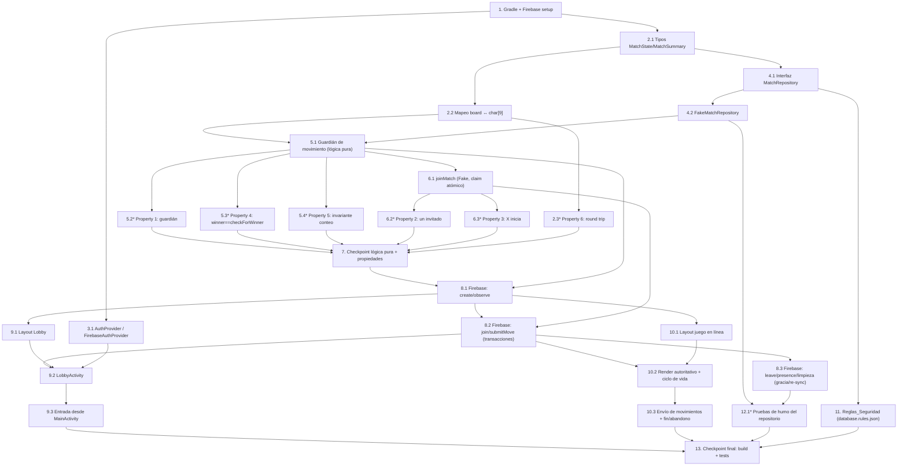

# Implementation Plan: Modo Multijugador en Línea (Reto 7 — "Jugando Triqui Online")

## Overview

Este plan convierte el diseño del **Modo_Online** en una serie de tareas de código incrementales para un proyecto estudiantil en **Java** sobre el codebase Android existente (`co.edu.unal.reto4_tictactoe`). Cada tarea se apoya en las anteriores y termina integrándose al conjunto; no quedan componentes huérfanos.

El orden de construcción va de los cimientos (Gradle/Firebase, modelo de datos, abstracción `MatchRepository` con un `FakeMatchRepository` en memoria y la lógica pura reutilizada) hacia la implementación real de Firebase y las pantallas (`LobbyActivity`, `OnlineGameActivity`), terminando con las Reglas_Seguridad, las pruebas de humo y la verificación final.

Principios:
- El **Modo_Local** (Humano X vs. Computadora O en `MainActivity`) es **intocable**; el modo en línea es **aditivo** (Req 21).
- La **nube es la fuente autoritativa** del `Estado_Partida`; el cliente reutiliza `TicTacToeGame`, `MoveGate`, `GameStatus` y `BoardView` para validación/render de UX (Req 20).
- Las **6 Propiedades de Corrección** (Property 1–6) se verifican con **jqwik** (ya configurado) sobre la lógica pura y un `FakeMatchRepository` en memoria, con un mínimo de **100 iteraciones** por propiedad.
- Fuera de alcance: chat, rankings, perfiles de usuario.

> **Convención de tareas marcadas con `*`:** las sub-tareas marcadas con `*` son pruebas (unitarias, de propiedades, de integración/humo). El `*` solo indica que son tareas de prueba. **En esta ejecución se ejecutan TODAS las tareas marcadas con `*`**: no se omiten. No existe un modo "MVP sin pruebas" en este plan; las pruebas de propiedades jqwik y las pruebas de humo forman parte del alcance que se corre completo. Las tareas de implementación central NO llevan `*`.

## Prerrequisitos de configuración manual (Firebase Console)

> **IMPORTANTE — pasos manuales del usuario/desarrollador, previos a la Tarea 1.** Estos pasos **no** son tareas de código, **no** los realiza el agente, y **no** se inventan ni versionan credenciales. Deben completarse manualmente en la Consola de Firebase antes de que la Tarea 1 pueda compilar/sincronizar con éxito:

1. **Crear/registrar la app Android** en un proyecto de Firebase, usando el nombre de paquete exacto `co.edu.unal.reto4_tictactoe`.
2. **Habilitar Anonymous Authentication** (Authentication → Sign-in method → Anónimo) para obtener un `uid` estable sin perfiles de usuario.
3. **Crear la Realtime Database** (RTDB) en el proyecto y anotar su URL/región.
4. **Descargar `app/google-services.json`** desde la Consola y **colocarlo manualmente** en el directorio del módulo `app/`.
   - Este archivo se provee **fuera de banda** (out-of-band) y está **gitignored**; **no** se incluye en la especificación ni se versiona con claves reales (Req 22.7).
5. Durante el desarrollo, las reglas en **modo de prueba** son aceptables solo temporalmente; **antes de la entrega/evaluación** deben reemplazarse por el ruleset de producción (ver Tarea 11). La **producción NO debe usar reglas abiertas**.

Ningún archivo de credenciales se genera, inventa ni commitea como parte de este plan.

## Tasks

- [x] 1. Configurar Gradle y dependencias de Firebase (primera tarea real de implementación)
  - **Prerrequisito:** los "Prerrequisitos de configuración manual (Firebase Console)" de arriba deben estar completos (en especial `app/google-services.json` colocado manualmente), de lo contrario esta tarea no sincroniza.
  - **Nota:** esta tarea modifica archivos de Gradle, lo cual estuvo **fuera de alcance en la fase de especificación**; aquí sí se realiza como primer paso de implementación.
  - En `gradle/libs.versions.toml`: añadir en `[versions]` `googleServices` y `firebaseBom`; en `[libraries]` `firebase-bom` (BoM), `firebase-database` y `firebase-auth` (sin versión, la fija el BoM); en `[plugins]` `google-services`.
  - En el `build.gradle.kts` del proyecto raíz (o `settings.gradle.kts`): declarar el plugin `google-services` con `apply false`.
  - En `app/build.gradle.kts`: aplicar `alias(libs.plugins.google.services)` y añadir `implementation(platform(libs.firebase.bom))`, `implementation(libs.firebase.database)`, `implementation(libs.firebase.auth)`.
  - Documentar que `app/google-services.json` se provee fuera de banda (no se versiona con claves reales) y añadirlo a `.gitignore`.
  - Verificar compatibilidad con minSdk 24, compileSdk/targetSdk 37, AGP 9.3.3, Java 11; dejar que el proyecto sincronice/compile.
  - _Requisitos: 6.1, 22.7_

- [x] 2. Definir el modelo de datos del Modo_Online y el mapeo de tablero
  - [x] 2.1 Crear tipos del Estado_Partida
    - Crear `GameLifecycle` (enum: `WAITING`, `PLAYING`, `FINISHED`, `ABANDONED`).
    - Crear `MatchState` (POJO: `matchId`, `hostUid`, `guestUid`, `board` string(9), `turn` `'X'`/`'O'`, `status`, `winner` int 0/1/2/3, `createdAt`, `updatedAt`, mapa `presence`).
    - Crear `MatchSummary` (vista ligera del Lobby: `matchId`, `hostUid`, `createdAt`).
    - _Requisitos: 1.1, 9.1, 9.2, 9.3, 11.1, 11.3, 13.3, 14.3_
  - [x] 2.2 Implementar helpers de mapeo `board` ↔ `TicTacToeGame char[9]`
    - Crear utilidades para serializar `char[9]` a cadena de 9 caracteres y de vuelta, usando `' '` como celda vacía y `'X'`/`'O'` para marcas; apoyarse en `TicTacToeGame.setBoardState/getBoardState`.
    - _Requisitos: 9.2, 13.3, 20.1_
  - [x]* 2.3 Escribir prueba de propiedad del round trip del tablero (jqwik)
    - **Property 6: Round trip del tablero (string de 9 ↔ `char[9]`)**
    - **Validates: Requirements 9.2, 13.3**
    - Comentario de etiqueta: `// Feature: online-multiplayer, Property 6: round trip del tablero`
    - Generar `char[9]` válidos, serializar, recargar con `setBoardState` y comparar; mínimo 100 iteraciones.

- [x] 3. Definir la identidad del Jugador (`AuthProvider`)
  - [x] 3.1 Crear la interfaz `AuthProvider` y `FirebaseAuthProvider`
    - Definir `AuthProvider` con `ensureSignedIn(onReady, onError)` y `currentUid()`.
    - Implementar `FirebaseAuthProvider` usando `FirebaseAuth.signInAnonymously()`; exponer el `uid` estable.
    - _Requisitos: 2.1, 22.2_

- [x] 4. Definir la abstracción de la nube y su doble en memoria
  - [x] 4.1 Crear la interfaz `MatchRepository` y tipos de apoyo
    - Definir `MatchRepository` con `observeOpenMatches`, `createMatch`, `joinMatch`, `observeMatch`, `submitMove`, `leaveMatch`, `registerPresence`.
    - Definir `ListenerHandle` (con `detach()`), `Listener<T>`, y callbacks tipados (`ResultCallback`, `JoinCallback` con `onUnavailable`, `MoveCallback`) para éxito/fallo.
    - _Requisitos: 6.1, 6.2, 16.1, 16.2, 17.2, 20.4_
  - [x] 4.2 Implementar `FakeMatchRepository` en memoria (base de pruebas)
    - Modelar el almacenamiento en memoria y el **comportamiento atómico** de `joinMatch` y `submitMove` con la misma lógica de validación que usará `FirebaseMatchRepository` (sin red).
    - Permitir emisión de callbacks a listeners al cambiar el estado para las pruebas del Lobby/partida.
    - _Requisitos: 6.1, 10.1, 14.1, 14.2, 15.1_

- [x] 5. Implementar la validación/orquestación de movimientos en línea (lógica pura reutilizada)
  - [x] 5.1 Implementar el guardián de movimiento del Modo_Online
    - Escribir la función pura que, dado un `MatchState`, el `uid` solicitante y la celda, decide si el movimiento es válido: `status==PLAYING`, solicitante es host/guest, su marca coincide con `turn`, y celda libre; reusar `MoveGate` para el gating de celda/fin de juego.
    - Aplicar el movimiento al `board`, calcular `winner` con `TicTacToeGame.checkForWinner`, pasar a `FINISHED` si `winner!=0` o alternar `turn` si continúa; usar `GameStatus` para mapear el resultado a texto.
    - Integrar esta lógica como núcleo compartido por `FakeMatchRepository` (y luego por `FirebaseMatchRepository`).
    - _Requisitos: 5.1, 5.2, 12.3, 14.1, 14.2, 14.3, 14.4, 20.1, 20.2, 23.1, 23.6_
  - [x]* 5.2 Escribir prueba de propiedad del guardián de movimiento (jqwik)
    - **Property 1: Guardián de movimiento (se aplica si y solo si es válido)**
    - **Validates: Requirements 5.1, 5.2, 12.3, 14.1, 14.2, 14.4, 23.1, 23.6**
    - Comentario de etiqueta: `// Feature: online-multiplayer, Property 1: guardián de movimiento`
    - Generar `MatchState`, solicitantes y celdas aleatorios; verificar aplicación/rechazo y que el estado quede sin cambios cuando se rechaza; mínimo 100 iteraciones.
  - [x]* 5.3 Escribir prueba de propiedad del resultado persistido (jqwik)
    - **Property 4: El resultado persistido coincide con `checkForWinner`**
    - **Validates: Requirements 14.3, 14.4**
    - Comentario de etiqueta: `// Feature: online-multiplayer, Property 4: winner == checkForWinner`
    - Para movimientos válidos, verificar `winner == checkForWinner(board)` y transición a `FINISHED` si y solo si `winner!=0`; mínimo 100 iteraciones.
  - [x]* 5.4 Escribir prueba de propiedad del invariante de conteo de marcas (jqwik)
    - **Property 5: Invariante de conteo de marcas por turnos alternados**
    - **Validates: Requirements 11.3, 14.1, 15.2**
    - Comentario de etiqueta: `// Feature: online-multiplayer, Property 5: invariante countX - countO ∈ {0,1}`
    - Aplicar secuencias de movimientos válidos y verificar `countX - countO ∈ {0,1}` en todo estado alcanzable; mínimo 100 iteraciones.

- [x] 6. Implementar la lógica de unión (claim atómico del slot de Invitado)
  - [x] 6.1 Implementar `joinMatch` en `FakeMatchRepository`
    - Transacción lógica: si `status!=WAITING` o `guestUid!=null` abortar (no disponible); si libre, fijar `guestUid=solicitante`, `status=PLAYING`, `turn="X"` (Anfitrión=X inicia), `updatedAt`; remover la entrada del `lobby`.
    - Invocar `JoinCallback.onUnavailable()` cuando la partida ya no esté disponible.
    - _Requisitos: 1.1, 1.2, 4.2, 10.1, 10.2, 10.3, 11.1, 11.3, 15.3, 16.2, 23.3_
  - [x]* 6.2 Escribir prueba de propiedad "exactamente un Invitado" (jqwik)
    - **Property 2: Exactamente un Invitado reclama una Partida WAITING**
    - **Validates: Requirements 1.1, 1.2, 10.1, 10.2, 10.3, 15.3, 23.3**
    - Comentario de etiqueta: `// Feature: online-multiplayer, Property 2: exactamente un invitado reclama la partida`
    - Simular solicitantes concurrentes sobre una partida WAITING; verificar que exactamente uno queda como `guestUid` y los demás son rechazados; mínimo 100 iteraciones.
  - [x]* 6.3 Escribir prueba de propiedad "X siempre inicia" (jqwik)
    - **Property 3: X siempre inicia**
    - **Validates: Requirements 11.3**
    - Comentario de etiqueta: `// Feature: online-multiplayer, Property 3: X siempre inicia`
    - Para toda partida que pasa a `PLAYING`, verificar `turn == "X"`; mínimo 100 iteraciones.

- [x] 7. Checkpoint — Asegurar que la lógica pura y las propiedades pasan
  - Ejecutar realmente (no asumir) las pruebas unitarias y de propiedades jqwik de las secciones 5 y 6 (Properties 1–5, mínimo 100 iteraciones cada una) y la de la sección 2 (Property 6).
  - Ensure all tests pass, ask the user if questions arise.

- [x] 8. Implementar `FirebaseMatchRepository` (RTDB real detrás de la abstracción)
  - **Nota de serialización:** las sub-tareas 8.1, 8.2 y 8.3 modifican la **misma clase** `FirebaseMatchRepository` y por eso DEBEN ejecutarse en orden estricto (8.1 → 8.2 → 8.3), nunca en paralelo.
  - [x] 8.1 Implementar creación, observación de Lobby y de partida
    - Implementar `createMatch` (clave `push()`, tablero vacío, `status=WAITING`, `turn="X"`, `hostUid`, timestamps, entrada en `/lobby`).
    - Implementar `observeOpenMatches` (listener sobre `/lobby`) y `observeMatch` (listener sobre `/matches/<id>`), devolviendo `ListenerHandle` con `detach()`.
    - Mapear snapshots a `MatchSummary`/`MatchState`; ninguna otra clase importa paquetes de Firebase.
    - _Requisitos: 3.1, 3.2, 6.1, 6.3, 8.1, 8.2, 8.3, 9.1, 9.2, 9.3, 17.1, 17.2, 20.4_
  - [x] 8.2 Implementar `joinMatch` y `submitMove` con transacciones RTDB
    - `joinMatch`: `runTransaction` que reclama el slot (reusa la lógica de la tarea 6.1), pasa a `PLAYING` y remueve `/lobby/<id>`.
    - `submitMove`: `runTransaction` que valida `status==PLAYING`, participante, turno y celda libre (reusa la lógica de la tarea 5.1), escribe `board`, calcula `winner` y actualiza `status`/`turn`/`updatedAt`.
    - **Nota de seguridad:** las transacciones RTDB dan **control de concurrencia para clientes cooperantes**, NO son una frontera de seguridad; un cliente manipulado puede intentar escrituras arbitrarias (ver Tarea 11).
    - _Requisitos: 1.2, 10.1, 10.2, 10.3, 13.1, 14.1, 14.2, 14.3, 14.4, 15.1, 15.2, 15.3, 23.1, 23.3, 23.6_
  - [x] 8.3 Implementar salida, presencia y limpieza (distinguiendo desconexión transitoria de abandono definitivo)
    - `leaveMatch` (salida **explícita/voluntaria**): marca `ABANDONED` si la partida está `PLAYING`, o remueve `/matches/<id>` y `/lobby/<id>` si es una `WAITING` del Anfitrión.
    - `registerPresence`: fija `presence/<uid>=true` y programa `onDisconnect()`:
      - Para una partida **`WAITING` solo con Anfitrión** (sin juego en curso): `onDisconnect` **puede remover** la `WAITING` (y su `/lobby/<id>`), pues no hay partida activa que preservar.
      - Para una partida **`PLAYING`**: una desconexión transitoria **NO** debe eliminar ni marcar `ABANDONED` la partida activa de inmediato. En su lugar, `onDisconnect` refleja ausencia poniendo `presence/<uid>=false`; el abandono definitivo solo ocurre por **salida explícita** (`leaveMatch`) o tras un **periodo de gracia / ausencia sostenida**. Esto permite que al reconectar y re-adjuntar `observeMatch` el jugador re-sincronice y **restaure** la partida activa desde el estado autoritativo.
    - La limpieza/TTL (barrido de partidas muertas) **NO** debe borrar partidas **`PLAYING`** por intermitencias de conectividad; solo retira `WAITING` huérfanas y partidas ya `FINISHED`/`ABANDONED`.
    - _Requisitos: 16.3, 18.1, 18.2, 18.3, 19.3, 23.2, 23.4, 23.5_

- [x] 9. Implementar `LobbyActivity` y el punto de entrada al Modo_Online
  - **Nota de serialización:** 9.2 y 9.3 tocan/dependen de la misma clase `LobbyActivity` y de `MainActivity`; se ejecutan tras 9.1 (layout) y en orden (9.2 → 9.3).
  - [x] 9.1 Crear el layout del Lobby
    - Crear `res/layout/activity_lobby.xml` con `RecyclerView` para partidas, botón "Crear partida", estado vacío e (opcional) campo para unirse por `matchId`.
    - _Requisitos: 3.3, 4.1_
  - [x] 9.2 Implementar `LobbyActivity`
    - En estado activo: `AuthProvider.ensureSignedIn` y luego `observeOpenMatches` (lista en tiempo real de partidas `WAITING`); desadjuntar listener en `onPause/onStop/onDestroy`.
    - Acción "Crear partida" (`createMatch` → abre `OnlineGameActivity` como Anfitrión) y "Unirse" (`joinMatch` → abre como Invitado); manejar estado vacío (Req 3.3) y rechazo por no disponible (`onUnavailable`) permaneciendo en el Lobby.
    - _Requisitos: 3.1, 3.2, 3.3, 4.1, 4.2, 4.3, 7.1, 7.2, 8.1, 8.2, 8.3, 16.2, 17.1, 17.2, 19.2_
  - [x] 9.3 Añadir el punto de entrada desde `MainActivity`
    - Añadir el ítem "Jugar en línea" a `res/menu/options_menu.xml` y lanzar `LobbyActivity` con un `Intent` desde `MainActivity`, sin alterar los ítems ni el comportamiento local existentes.
    - _Requisitos: 7.1, 21.1_

- [x] 10. Implementar `OnlineGameActivity`
  - **Nota de serialización:** 10.2 y 10.3 modifican la misma clase `OnlineGameActivity`; se ejecutan tras 10.1 (layout) y en orden (10.2 → 10.3).
  - [x] 10.1 Crear el layout de juego en línea
    - Crear `res/layout/activity_online_game.xml` con un `BoardView`, indicador de estado/turno, estado de espera y acción "Volver al Lobby".
    - _Requisitos: 12.1, 13.2, 19.1_
  - [x] 10.2 Implementar render autoritativo y ciclo de vida de listeners
    - Mantener un `TicTacToeGame` local de solo render; en cada `MatchState` llamar `setBoardState(board)` + `boardView.invalidate()` y mapear `winner`/`turn` con `GameStatus`.
    - Adjuntar `observeMatch(matchId)` y `registerPresence` en estado activo; desadjuntar en `onPause/onStop/onDestroy`. Al re-adjuntar tras una desconexión, re-sincronizar desde el `MatchState` autoritativo (no asumir abandono por una caída transitoria).
    - Mostrar estado de espera mientras `WAITING` (bloquear movimientos) y tablero jugable al pasar a `PLAYING`.
    - _Requisitos: 5.2, 11.2, 12.1, 12.2, 12.3, 13.1, 13.2, 13.3, 16.3, 17.1, 17.2, 17.3, 20.3, 23.2_
  - [x] 10.3 Implementar envío de movimientos y manejo de fin/abandono
    - En `OnMoveListener.onMoveSelected(cell)`: aplicar gating de UX con `MoveGate.shouldApply` y luego `submitMove(matchId, cell, ...)`.
    - Al `FINISHED`: mostrar resultado y ofrecer "Volver al Lobby" (desadjuntando listeners al volver); al `ABANDONED` por salida explícita del oponente: informar y ofrecer volver; ante desconexión transitoria del oponente, informar ausencia sin cerrar la partida y permitir la re-sincronización si vuelve; manejar errores de conexión manteniendo estado consistente.
    - _Requisitos: 5.1, 13.1, 14.1, 14.2, 16.1, 16.3, 18.1, 18.2, 19.1, 19.2, 23.2, 23.5_

- [x] 11. Crear el archivo de Reglas_Seguridad de producción
  - Crear `database.rules.json` con el ruleset de producción **bloqueado** (la producción **NO** debe usar reglas abiertas/modo de prueba), que haga cumplir lo que **sí** es expresable en reglas de RTDB:
    - `auth != null` para toda lectura/escritura (solo usuarios identificados).
    - Un match existente **solo** lo escriben `hostUid` o `guestUid`; un tercero únicamente puede reclamar el slot de Invitado cuando el match está `WAITING` y el slot vacío.
    - `.validate` fuerza la forma del dato: `board` string de **9 caracteres**, y presencia/forma de `status`, `turn`, `winner`, `hostUid`.
  - **Nota de alcance de seguridad (corrección de sobre-afirmación):** las transacciones del cliente ofrecen **control de concurrencia para clientes cooperantes**, pero **NO constituyen una frontera de seguridad**. Un cliente manipulado/malicioso puede intentar escrituras arbitrarias. Las reglas de RTDB restringen *quién* escribe y *la forma* del dato, pero **no** pueden recomputar toda la legalidad de turno ni recalcular el `winner`. Para hacer cumplir plenamente esos invariantes de reglas de juego frente a un cliente manipulado se requeriría **lógica del lado del servidor** (p. ej. Cloud Functions / validación autoritativa en servidor). Documentar explícitamente **cuándo** se requiere esa lógica de servidor (cuando no se pueda confiar en el cliente y se necesite imponer legalidad de turno/recálculo de ganador más allá de lo expresable en reglas RTDB).
  - Añadir una nota breve (en el README o un `SECURITY.md`) con el procedimiento de reemplazo del modo de prueba por producción; no incluir credenciales ni `google-services.json` con claves reales.
  - _Requisitos: 1.2, 15.3, 22.1, 22.2, 22.3, 22.5, 22.6, 22.7_

- [x] 12. Pruebas de ejemplo/humo de la capa de repositorio (detrás de la abstracción)
  - [x]* 12.1 Escribir pruebas de ejemplo con `FakeMatchRepository` (1–3 casos)
    - Verificar: el Lobby emite callbacks al aparecer/desaparecer una `WAITING`; dos listeners del mismo match reciben el mismo `MatchState` tras una escritura; `joinMatch` sobre match no disponible invoca `onUnavailable`; salida explícita (`leaveMatch`) marca `ABANDONED` o remueve la `WAITING` huérfana; una ausencia transitoria (`presence=false`) NO cierra una partida `PLAYING`.
    - _Requisitos: 6.3, 8.2, 8.3, 16.2, 16.3, 18.1, 18.3, 23.2_

- [x] 13. Checkpoint final — Compilar y verificar sin romper el Modo_Local
  - Estas verificaciones **deben ejecutarse realmente, no asumirse**:
    - (a) **Compilar/build** el proyecto completo.
    - (b) **Ejecutar las pruebas unitarias** (JVM) con el flag de ejecución única.
    - (c) **Ejecutar las pruebas de propiedades jqwik** (Properties 1–6, mínimo **100 iteraciones** cada una) y confirmar que pasan.
    - (d) **Confirmar que las pruebas existentes del Modo_Local** (unitarias e instrumentación: `BoardViewDrawInstrumentationTest`, `BoardViewLayoutInstrumentationTest`, `MenuDialogRegressionInstrumentationTest`, etc.) siguen válidas y verdes.
  - Ensure all tests pass, ask the user if questions arise.
  - _Requisitos: 21.1, 21.2, 21.3_

## Notes

- Las sub-tareas marcadas con `*` son tareas de prueba. **En esta ejecución se corren TODAS** (unitarias, de propiedades jqwik y de humo); no se omiten. El `*` solo las distingue como pruebas, no como "opcionales a saltar".
- Cada tarea referencia requisitos específicos para trazabilidad.
- Las 6 propiedades de corrección se verifican con **jqwik** (ya configurado), con un mínimo de 100 iteraciones y una prueba de propiedad por cada propiedad.
- Serialización por clase compartida: 8.1→8.2→8.3 (misma `FirebaseMatchRepository`), 9.2→9.3 (misma `LobbyActivity`/`MainActivity`), 10.2→10.3 (misma `OnlineGameActivity`). Nunca se ejecutan en paralelo sub-tareas que escriben la misma clase.

### Verificación manual pendiente (no automatizable)

> Las siguientes verificaciones **NO son tareas de código auto-completables** y **NUNCA deben marcarse como aprobadas/pasadas sin haberse ejecutado realmente**. Requieren la Consola de Firebase y/o dispositivos físicos:

- **Latencia real de propagación (≤ 3 s)** entre dos dispositivos: medir manualmente con **dos dispositivos físicos** (Req 8, 23). No es candidata a property test (servicio externo + temporización).
- **Presencia / `onDisconnect` sobre red real**: comprobar manualmente que una desconexión transitoria en `PLAYING` NO borra la partida y que al reconectar se re-sincroniza; y que una `WAITING` huérfana del Anfitrión sí desaparece (Req 16.3, 18.2, 18.3, 23.2).
- **Reglas_Seguridad desplegadas**: verificar con el **simulador de reglas** de la Consola de Firebase que un usuario no autenticado es rechazado, que un tercer uid no puede escribir en un match completo, y que un uid participante sí puede (Req 22.*). Confirmar que **producción no usa reglas abiertas**.

Estas quedan como **Verificación manual pendiente** hasta ejecutarse con el entorno real; no deben darse por aprobadas automáticamente.

## Task Dependency Graph

```json
{
  "waves": [
    { "id": 0, "tasks": ["1"] },
    { "id": 1, "tasks": ["2.1", "3.1"] },
    { "id": 2, "tasks": ["2.2", "4.1"] },
    { "id": 3, "tasks": ["2.3", "4.2", "11"] },
    { "id": 4, "tasks": ["5.1"] },
    { "id": 5, "tasks": ["5.2", "5.3", "5.4", "6.1"] },
    { "id": 6, "tasks": ["6.2", "6.3"] },
    { "id": 7, "tasks": ["7"] },
    { "id": 8, "tasks": ["8.1"] },
    { "id": 9, "tasks": ["8.2"] },
    { "id": 10, "tasks": ["8.3"] },
    { "id": 11, "tasks": ["9.1", "10.1"] },
    { "id": 12, "tasks": ["9.2", "10.2"] },
    { "id": 13, "tasks": ["9.3", "10.3", "12.1"] },
    { "id": 14, "tasks": ["13"] }
  ]
}
```


